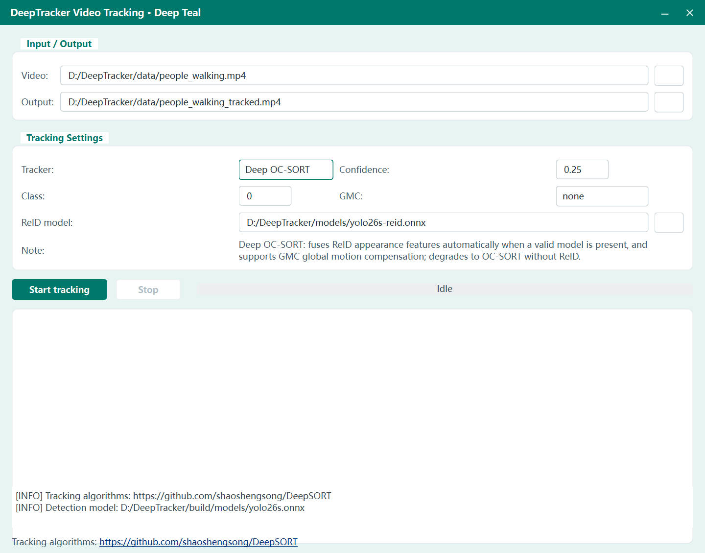

# DeepTracker

Real-time multi-object tracking for video, written in C++17 with Qt 6, OpenCV and ONNX Runtime. A YOLO detector feeds one of four classic tracking algorithms behind a single C++ interface, with a Qt desktop application for interactive use and a command-line demo for scripting.

> To try it immediately, run `build\track_gui_qt.exe`, choose a video, and press **Start tracking** — live preview, bounding boxes, track IDs and trajectory trails appear as the video plays.
## Look

## Tracking Algorithms

All trackers implement the same thin `ITracker` interface (`update` / `reset` / `frame_id`), so switching algorithms is a one-line change.

| Tracker | Association | ReID | Description |
|---|---|---|---|
| **ByteTrack** | Motion (IoU + confidence) | No | Two-stage association: high-score detections are matched first, then low-score leftovers recover tracks briefly lost to occlusion. |
| **OC-SORT** | Motion (observation-centric) | No | Observation-Centric SORT built from OCM (velocity-direction cost), OCR (re-association with the last observation) and ORU (virtual observation back-fill on re-acquisition). Handles occlusion and motion blur without any appearance model. |
| **Deep OC-SORT** | Motion + appearance | Optional | OC-SORT augmented with ReID feature fusion and Global Motion Compensation (GMC) for moving-camera footage. ReID engages automatically when the model file is present, otherwise it runs as plain OC-SORT. |
| **DeepSORT** | Appearance + motion | Required | A faithful implementation of Wojke et al., ICIP 2017: age-ordered cascade matching, a feature gallery of the last 100 frames matched by minimum cosine distance, squared-Mahalanobis motion gating (χ², 4 dof = 9.4877), and a second IoU association stage for tentative and just-lost tracks. Falls back to ByteTrack when no ReID model is available. |

Every tracker follows the same track lifecycle: a new track starts **tentative**, is confirmed after `n_init = 3` consecutive associations, is kept alive while lost up to `track_buffer = 30` frames, and association never crosses object classes.

## Architecture

- **`ITracker`** — the minimal interface shared by every algorithm (`update` / `reset` / `frame_id`).
- **`BaseTracker`** — a template-method pipeline (detection split → predict → first association → recovery → second association → unconfirmed association → new-track init → pool merge). ByteTrack, OC-SORT and Deep OC-SORT are policy combinations on this pipeline through virtual hooks.
- **`DeepSortTracker`** — a self-contained algorithm with its own cascade-matching loop; it implements `ITracker` directly rather than inheriting the shared pipeline.
- **Association utilities** — IoU/embedding distance matrices, score fusion, and a Jonker–Volgenant (LAPJV) linear assignment solver.
- **Filtering** — a constant-velocity Kalman filter on the `[cx, cy, aspect, height]` state for all trackers.

Detection and appearance features run through ONNX Runtime, so models are plain `.onnx` files that can be upgraded without recompiling. Inference defaults to the CPU execution provider; CUDA, DirectML, OpenVINO and other providers can be selected without touching the tracking code.

## Directory Layout

```
DeepTracker/
├── src/
│   ├── core/        # trackers, Kalman filter, LAPJV solver, GMC, track objects, config presets
│   ├── detector/    # ONNX YOLO detector (letterbox preprocess, output decode, NMS)
│   ├── reid/        # ONNX appearance encoder (L2-normalized embeddings)
│   ├── app/gui/     # Qt application (deeptracker_gui.pro) and a legacy Win32 demo
│   └── app/cli/     # track_demo.cpp command-line demo
├── models/          # yolo26s.onnx (detection), yolo26s-reid.onnx (appearance)
├── data/            # sample videos
├── scripts/         # export_yolo26_onnx.py (PyTorch -> ONNX)
└── external/        # prebuilt OpenCV and ONNX Runtime (not committed)
```

## Building

1. Install **Visual Studio 2022** (MSVC v143, x64) and **Qt 6.9.x** with the MSVC 2022 64-bit kit.
2. Place OpenCV and ONNX Runtime under `external/` (`external/opencv/build`, `external/onnxruntime`).
3. Double-click **`src/app/gui/deeptracker_gui.pro`** to open it in Qt Creator, then click **Build** and **Run**.

The executable is deployed to `build\` together with the required DLLs and models; that folder is portable and can be copied anywhere. All paths in the `.pro` file are relative, so the project builds from any location.

## Usage

1. Run `build\track_gui_qt.exe`.
2. Pick an input video (for example `data\people_walking.mp4`); the output path is filled in automatically.
3. Choose a tracker, confidence threshold and object class; for Deep OC-SORT you can also select a GMC method (`none`, `sparseOptFlow`, `orb`, `sift`, `ecc`) for moving cameras.
4. Press **Start tracking**. The progress bar reports frame progress and active track count, and the log panel records model loading and tracker selection.
5. The palette button in the title bar switches between color themes (the choice is remembered).

Models are discovered automatically next to the executable (`models\`, searching upward through parent directories). The command-line demo offers the same functionality headlessly:

```
track_demo --tracker deepsort --source video.mp4 --out result.mp4
```

Supported `--tracker` values: `bytetrack`, `ocsort`, `deepocsort`, `deepsort`.

## Models

| File | Purpose |
|---|---|
| `models\yolo26s.onnx` | YOLO detector, 640×640 input (person class by default) |
| `models\yolo26s-reid.onnx` | Appearance encoder producing L2-normalized embeddings |

Tracker parameters live as compiled-in presets in `src/core/tracker_config.cpp` (`TrackerConfig::defaults_for`) — confidence gates, track buffer, association thresholds, GMC method and ReID settings. Tune a preset and rebuild to change behavior.

## Credits

- DeepSORT — Wojke et al., ICIP 2017
- ByteTrack — Zhang et al., ECCV 2022
- OC-SORT — Cao et al., ECCV 2023
- Deep OC-SORT — Maggiolino et al., 2023


